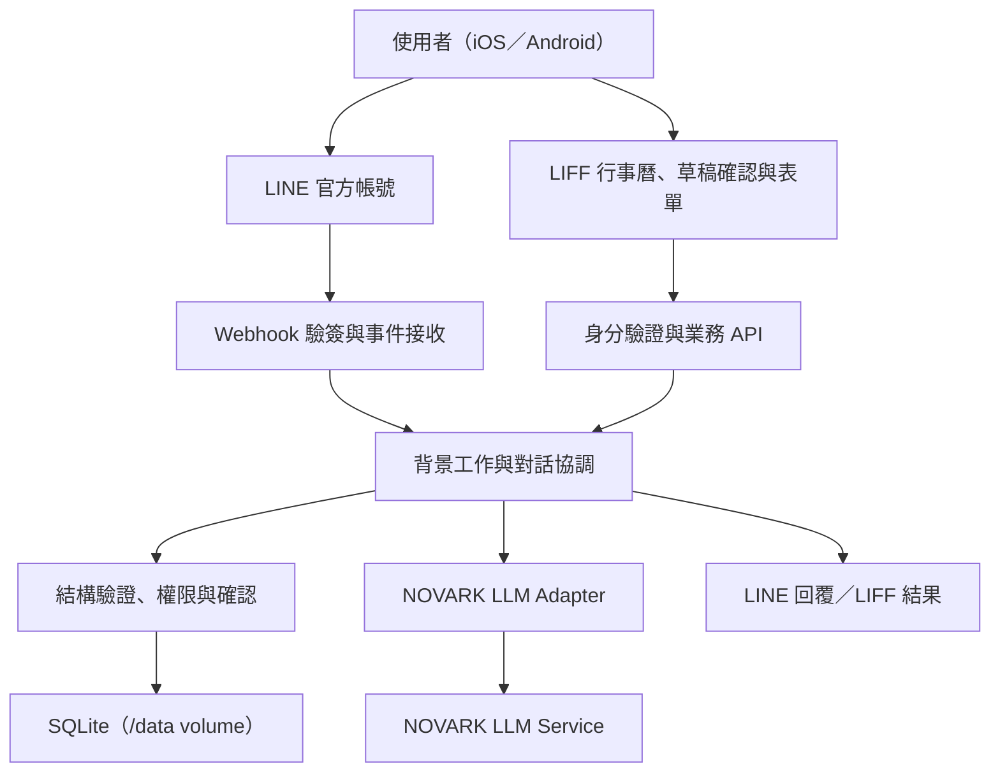
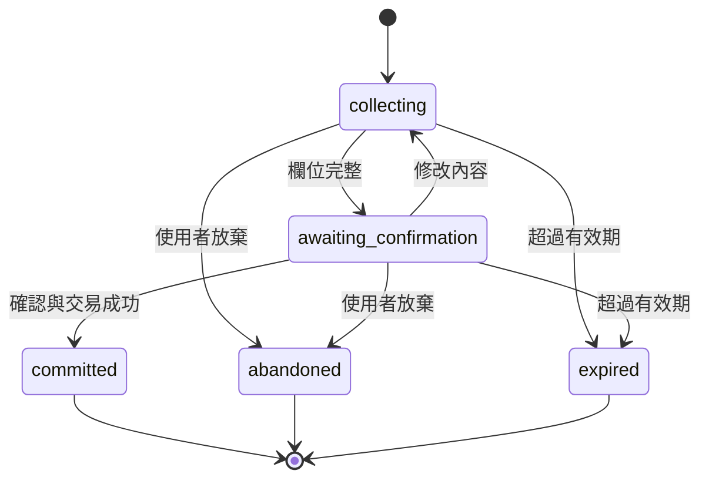

# LINE 團隊行程助理｜系統設計 v1.2

- 文件日期：2026-10-24
- 階段：第一版系統設計，供需求確認與開發使用。
- 使用情境：使用者直接在 LINE 對話輸入，經 NOVARK LLM 解析成行程草稿，確認後存入系統，再以對話或 LIFF 查詢。
- v1.2 變更（2026-10-24 CEO 審查決策）：v1 聚焦「LINE 對話 → NOVARK LLM → 行程」。Google、Apple iCloud、Microsoft Outlook 行事曆讀取及共用的 ICS 匯入流程改列 TODO（見 `TODOS.md` 與附錄 A），不在 v1 實作範圍。
- v1.2 補充決策（2026-10-25）：Reply 優先與 Push 額度策略（§10）、團隊可見性追溯與停權隱藏（§7.1）、跨年日期推定（§6）、稽核紀錄只存欄位名（§8）、NL 解析評測集與門檻（§14.1）、邀請兌換確認與重綁（§4.3）；NOVARK 實際 API 契約、input_guard 規則與錯誤對應（§3.1.1–3.1.3）。Eng review（2026-10-25）：移除 PydanticAI 與 LIFF 對話輸入、Reply 截止時間與 Worker 並行（§10-4）、guardrail 退路（§3.1.2）、offset 正規化（§3.1.1）、「這週X」與非文字訊息規則（§6）、測試策略（§14.2）。
- SQLite 決策（2026-10-25）：資料量小，正式環境改用專案內的 SQLite，與服務一起部署為單一 Docker image（資料檔案放在掛載的 volume）；取代原本的 PostgreSQL（§2、§8、§10、§12、§14.2）。
- v1.1 變更：新增選用式行事曆讀取、逐筆勾選匯入、連線管理、來源追蹤及匯入防重（v1.2 起移至附錄 A，延後實作）。
- 設計原則：LIFF 與官方帳號共用業務後端；NOVARK 僅供應 LLM 能力；行程、權限、確認與寫入由本系統負責。

## 1. 目標與範圍

### 1.1 第一版範圍

1. LINE 登入、組織成員綁定與團隊管理。
2. LINE 官方帳號一對一聊天（唯一的對話入口；LIFF 不提供對話輸入）。
3. 自然語言新增、修改、取消行程；寫入前顯示確認卡。
4. LIFF 我的行程、團隊週曆、清單與表單編輯。
5. 個人、指定同事、團隊的日期區間查詢。
6. 私人、僅顯示忙碌、團隊詳細資訊三種分享設定。
7. 操作紀錄、重複請求防護、NOVARK 呼叫監控。

### 1.2 不包含

- **外部行事曆讀取與匯入（TODO）**：Google Calendar、Apple iCloud、Microsoft Outlook 連線，以及 ICS 檔案匯入。設計保留於附錄 A，待 v1 驗證對話建檔使用率後再排入。
- 讀取 iOS／Android 本機行事曆。
- 自動持續同步、來源事件寫回、雙向同步。
- 群組聊天室收集行程、代他人建檔、共同會議邀請。
- 對話建立／管理週期性規則、語音輸入、一般附件解析、自動提醒及自動安排會議。
- RAG、向量資料庫、由模型產生 SQL 直接執行。

上述需求若出現，系統應清楚說明暫不支援，不能靜默轉成不同操作。

### 1.3 第一版預設決策

| 項目 | 設計預設 |
|---|---|
| 組織 | 初期單公司部署，資料結構保留 organization_id |
| 成員 | 一位成員可加入多個團隊；初期一個 LINE 身分綁定一個啟用中的公司帳號 |
| 行程擁有者 | 目前登入者，不接受模型或前端指定其他擁有者 |
| 時區 | Asia/Taipei，可保留使用者時區欄位 |
| 未提供結束時間 | 預設 60 分鐘，在確認卡標記「預設」 |
| 預設分享 | **團隊詳細資訊**（2026-10-25 決策：登錄行程就是要讓團隊了解，使用者不需選擇分享範圍；確認卡與 LIFF 不再出現分享選項。對話中說「改成私人」仍可設為私人） |
| 查詢範圍 | 同公司且至少共屬一個團隊；仍需符合每筆行程分享設定 |
| 修改與取消 | 只允許本人，且每次須確認 |
| 無行程 | 回覆「本系統沒有已登錄行程」，不得保證有空 |
| 外部行事曆 | v1 不提供；匯入相關預設見附錄 A |

這些是可調整的產品預設，不代表公司現有規章。

## 2. 整體架構



### 2.1 元件責任

| 元件 | 責任 |
|---|---|
| LIFF 前端 | 登入、草稿檢視與確認、週曆、清單、表單與分享設定（不含對話輸入） |
| FastAPI 後端 | 驗證、授權、API、行程資料、確認交易與稽核 |
| 對話協調服務 | 意圖解析、追問、候選選擇、草稿管理、回覆組裝 |
| NOVARK Adapter | 封裝端點、Service Token、請求與回應格式、逾時及錯誤轉換 |
| 規則服務 | 日期、欄位、分享範圍、目標事件與狀態檢查 |
| 背景工作 | Webhook 非同步處理、LLM 呼叫與訊息發送 |
| SQLite | 正式行程、草稿、對話狀態、工作佇列、操作紀錄；單一檔案放在掛載的 volume（§12） |

建議 Python＋FastAPI＋Pydantic＋SQLAlchemy／Alembic，前端 React＋TypeScript＋LIFF SDK。NOVARK 為自訂 Agent 端點（§3.1.1），不使用 PydanticAI 等模型框架；Adapter 以 httpx（非同步、共用連線池）＋Pydantic 結構驗證實作。第一版不依賴 NOVARK 的工具呼叫或 Agent 能力。

## 3. NOVARK LLM 串接

### 3.1 呼叫邊界

```text
LINE 訊息 → 本系統後端 → NOVARK LLM → 結構化解析結果
                                      ↓
                            後端驗證、確認、寫入
```

**NOVARK Service Token 僅存於後端 Secret／環境變數，不放在 LIFF JavaScript、瀏覽器儲存空間、URL 或 LINE 訊息中。** LIFF 呼叫的是本系統 API；本系統再使用 Service Token 呼叫 NOVARK。

| 設定 | 說明 |
|---|---|
| NOVARK_BASE_URL | `https://core.novark.cloud` |
| NOVARK_AGENT | `llm_agent`（端點 `POST /api/agents/{agent}/run`） |
| NOVARK_SERVICE_TOKEN | `sat_…` 服務憑證，需授予 `agent:invoke` 於 `llm_agent`；只在後端 Secret 讀取，各環境分開 |
| NOVARK_INPUT_GUARD | 聊天輸入預設 `true`（見 §3.1.2） |
| NOVARK_CHAT_BUDGET_SECONDS | 聊天路徑的總時間預算（含重試），配合 Reply 可用時間設定，預設保守值、以實測調整 |
| NOVARK_HTTP_TIMEOUT_SECONDS | 背景路徑的 HTTP 逾時，須大於平台單次上限約 120 秒，建議 130 |
| NOVARK_MAX_RETRIES | 僅網路錯誤、429、503 重試，最多 2 次，退避＋抖動，且不得超過所在路徑的時間預算 |
| NOVARK_TEMPERATURE | `0.1`（不視為格式保證） |
| NOVARK_MAX_TOKENS | `512`（限制結構化輸出長度） |

#### 3.1.1 NOVARK 實際契約（2026-10-25 取得並實測）

- **請求**：`POST https://core.novark.cloud/api/agents/llm_agent/run`；Header `Authorization: Bearer <service token>`、`Content-Type: application/json`、`X-Trace-Id: <本系統 request_id（UUID）>`。
- **X-Acting-User**：本案 token **未開啟**「要求代理身分」（2026-10-25 管理員確認），因此**不可帶**此 header（帶了回 400）。若日後改開啟，需改帶本系統內部 user UUID（不帶 LINE userId）。
- **平台限制**（2026-10-25 管理員確認）：`llm_agent` 無同時執行數與頻率限制、無單次 token 上限。本系統仍自設並行上限與每人限流（§12），以控制成本與避免單一使用者占滿資源；429／422 的處理仍保留，防範平台設定日後變更。
  - **實測與上述不符（2026-10-25）**：同時送 4 個請求時，第 4 個回 `429`（`retry-after: 1`，「目前請求較為頻繁，請稍候幾秒再試」）；並行 8 跑評測時大量 429，並行 2 偶爾 429。Adapter 已依 `Retry-After` 等待後重試。`WORKER_CONCURRENCY` 預設 8 必須依實測下修，或請平台確認實際限制。
- **Body**：`{"inputs": {input_guard, system_prompt, prompt | messages, response_format: "json", temperature, max_tokens}, "idempotency_key"}`。`response_format="json"` 會強制關閉 thinking，結果放在 `output.json`。
- **冪等**：`idempotency_key` 使用 `request_id`＋嘗試用途（例如 `parse:{request_id}`）。同 key 同 inputs 重送會直接回傳上次結果，因此逾時後重試不會重複計費，也能在背景取回已完成的結果。
- **多輪**：平台不保存對話。追問時由本系統帶入 `pending_draft`（優先），必要時才用 `messages`（最多 200 則）；system 指令一律放 `system_prompt`。
- **回應判斷**：HTTP 200 不代表成功，一律以 `success` 判斷。回應另含未列於文件的欄位（例如 `usage_calls`），**外層回應模型必須允許未知欄位**；嚴格 Schema 只套用在 `output.json` 的業務內容。
- **實測（`11/1 14:00 國網中心拜訪`）**：`input_guard=true` 約 8.6 秒、1,330 tokens（其中 Guardrail 1,095）；`false` 約 5.6 秒、235 tokens。模型為平台設定的 vLLM／Kimi-K3。
- **實測發現的提示詞問題**：模型把「國網中心」**自行補成地點**（違反 §3.4-3）；把未提供的結束時間列為 `missing_fields`（本系統預設 60 分鐘，不應追問）；`start_local` 帶了 `+08:00`。這三項須在 system_prompt 明確規範，並列入 §14.1 評測集。
- **offset 正規化**：`start_local`／`end_local` 若帶 offset，且與使用者時區在該時刻的 offset 相同，就去掉 offset、視為當地時間；不同則視為歧義，回 `needs_clarification` 追問，不自行換算。

#### 3.1.2 input_guard 使用規則

- LINE 聊天是真人即時輸入，依平台建議設 `input_guard=true`，用來攔截 prompt_injection／social_engineering。
- 被攔下時回 `success=true` 且帶 `output.guardrail`：Adapter 對應為 `unsupported`（`category="pii"` 則提示「請勿輸入個資」），**不重試、不寫入**。回覆附「改用表單建立」LIFF 連結，讓誤判時仍有退路。
- 攔截事件記錄 `trace_id`、`category`、時間與使用者 ID，**不記錄原文**；每週檢查攔截率與使用者回報，確認的誤判案例（由本人同意提供或改寫後）加入 §14.1 評測集。
- 平台 InputPII 目前為**關閉**（2026-10-25 管理員確認），所以 Guardrail 不做個資偵測，回應也不會出現 `output.input_text`。對話原文依本系統保留政策處理（§12）。若日後開啟 mask，草稿與對話紀錄必須改存 `output.input_text`，不存原文。
- Guardrail 約增加 2–3 秒與 1,000 tokens。這是安全與時間預算之間的取捨，上線前以評測集量測 p95 後再確認。

#### 3.1.3 錯誤對應

| NOVARK 回應 | 本系統錯誤碼 | 重試 | 使用者看到 |
|---|---|---|---|
| 200 `success=true`，`output.json` 通過驗證 | — | — | 確認卡／追問 |
| 200 `success=true`，`parse_error` 非空 | `llm_malformed_output` | 修復 1 次 | 仍失敗則改用表單 |
| 200 `success=true`，`output.text` 空白 | `llm_empty_output` | 1 次 | 改用表單 |
| 200 `success=true`，帶 `output.guardrail` | `llm_guardrail_blocked` | 否 | 「無法處理此要求」 |
| 200 `success=false`，`error_code=provider_unavailable` | `llm_provider_unavailable` | 否，告警 | 稍後或改用表單 |
| 422 `token_budget_exceeded` | `llm_token_budget` | 否 | 請縮短內容或改用表單 |
| 429／503／網路逾時 | `llm_rate_limited`／`llm_upstream` | 是（同 idempotency_key） | 稍後或改用表單 |
| 400／401／402／403／404 | `llm_config_error`（記 `detail.error_code`） | 否，立即告警 | 服務暫不可用、可用表單 |

`llm_call_logs` 記錄 `trace_id`、`duration_ms`、`token_usage`、`binding_snapshot_id`、本系統錯誤碼與 NOVARK `error_code`，不記錄完整提示詞。

### 3.2 Adapter 內部契約

以下為本系統內部資料格式，不是 NOVARK 原生 API：

```json
{
  "request_id": "uuid",
  "task": "parse_schedule_intent",
  "context": {
    "now": "2026-10-24T20:00:00+08:00",
    "timezone": "Asia/Taipei",
    "locale": "zh-TW",
    "default_duration_minutes": 60
  },
  "message": "11/1 14:00 國網中心拜訪",
  "pending_draft": null
}
```

Adapter 將此格式轉成 NOVARK 支援的請求；回應抽取文字或 JSON 後，以 Pydantic 驗證。可用低溫度設定時採低溫度，但不能把低溫度視為格式保證。若服務不支援結構化輸出，使用 JSON 提示及驗證；格式錯誤最多修復一次，仍失敗則提示改用表單，不得自行補造內容。

### 3.3 模型輸出格式

```json
{
  "schema_version": "1.0",
  "intent": "create",
  "event": {
    "title": "國網中心拜訪",
    "start_local": "2026-11-01T14:00:00",
    "end_local": null,
    "timezone": "Asia/Taipei",
    "all_day": false,
    "location": null,
    "notes": null,
    "visibility": null
  },
  "target": null,
  "query": null,
  "missing_fields": [],
  "ambiguities": []
}
```

- intent 列舉：create、update、cancel、query、clarify、unsupported。
- update／cancel 的 target 僅包含日期、時間、標題等搜尋條件；模型不得自行決定資料庫 ID。
- query 包含人員名稱、日期區間、標題關鍵字；名稱由後端解析為授權範圍內的成員 ID。
- 模型提供解析結果，預設時長、預設分享、正式擁有者及可否執行由後端決定。
- JSON Schema 禁止額外欄位；標題、文字及查詢區間設定長度與大小上限。

### 3.4 提示詞原則

1. 系統明確提供現在日期與時區，不能依模型內部時間判斷。
2. 原始使用者文字是資料，不能覆蓋系統規則。
3. 不憑空補地點、地址、參與者、客戶名稱或結束時間。
4. 缺少必要資料時回傳 missing_fields；有歧義時回傳 ambiguities。
5. 不宣稱已寫入、已取消或已授權；正式操作由後端完成。
6. （v1 無外部行事曆匯入；未來實作時，外部結構化資料不送 NOVARK，見附錄 A。）
7. 優先只傳當次訊息與必要草稿。團隊查詢先由後端授權及遮蔽，再決定是否交模型整理。
8. 第一版查詢結果與確認卡優先使用固定模板，減少模型再次生成造成資料偏差。

## 4. 身分與成員綁定

### 4.1 LINE 設定

- 建立 LINE Official Account、Messaging API Channel、LINE Login Channel 與 LIFF App。
- Login 與 Messaging API Channel 建議置於同一 LINE Provider，以對應同一使用者識別。
- LIFF 使用 openid，需顯示資料時才增加 profile scope。
- 官方帳號選單提供「我的行程」「團隊行程」「新增行程」，分別開啟 LIFF 的 `/`、`/team`、`/new`。以 `python -m app.richmenu` 建立並設為預設，圖片為 `backend/app/assets/richmenu.png`（由 `deploy/make_richmenu_image.py` 產生）。
- 第一版只處理一對一 user 來源；group／room 不處理業務資料。

### 4.2 登入流程

1. 前端初始化 LIFF，取得原始 ID token，透過 HTTPS 交給後端。
2. 後端透過 LINE 官方驗證流程驗證 token，檢查指定 Channel audience、有效期與身分。
3. 以驗證後的 sub 對應本系統帳號；不信任前端傳入的 userId、姓名或角色。
4. 發行短效本系統 session；建議同網域、HttpOnly、Secure Cookie，採適合登入流程的 SameSite 設定，變更操作另設 CSRF 防護。
5. 未綁定成員只看到綁定頁，不能查詢公司名單及行程。

### 4.3 成員建立與綁定

- 管理員先建立成員，再發出單次使用、72 小時到期且綁定目標成員的邀請連結／邀請碼。
- 使用者 LINE 登入後兌換，後端交易內檢查有效期、使用次數與既有綁定。兌換頁先顯示目標成員姓名，由本人確認「這是我」後才完成綁定；不符則取消，邀請保持可用。
- 管理員可撤銷某成員的 LINE 綁定（例如換手機或換 LINE 帳號）：撤銷時立即使該成員所有 session 與待確認草稿失效，再重新發出邀請。撤銷與重綁均寫入稽核紀錄。
- **實作（2026-10-25）**：
  - 服務在 `backend/app/auth/`，API 在 `backend/app/api/auth.py`。v1 沒有管理頁，以 CLI `python -m app.cli` 建立組織、成員、團隊與邀請，也用來撤銷綁定、停權。
  - 兌換分兩步：先呼叫 `POST /api/invitations/preview` 顯示姓名，本人確認後再呼叫 `POST /api/invitations/redeem`（邀請 token＋LINE ID token）。
  - 對同一位成員發新邀請，會撤銷他舊的、還沒用過的邀請。
  - 停權（`set-status`）會撤銷所有 session、放棄未完成草稿，但保留 LINE 綁定，復職不必重新邀請；`revoke-binding` 才會刪除綁定。
  - Session 存在 HttpOnly＋Secure＋SameSite=Lax 的 `sid` Cookie，12 小時到期；變更操作以 double-submit 驗證 CSRF（`csrf` Cookie 對應 `X-CSRF-Token` header）。
- 不以可自由修改的 LINE 暱稱或自行輸入姓名自動取得公司身分。
- Webhook 的 userId 只有在驗簽成功後才可使用，且仍需對應啟用成員。
- 停權／離職即撤銷 session、阻擋聊天操作，並依資料保留規則處理既有行程。

## 5. 對話與寫入流程

### 5.1 新增

1. 驗證使用者與輸入長度。
2. 呼叫 NOVARK 解析，後端驗證日期與欄位。
3. 缺資料則追問，將答案合併至原草稿。
4. 產生草稿與確認卡，包含完整日期、星期、時間、標題、地點、分享範圍及預設項目。
5. 使用者點選確認，後端重新驗證身分、權限、草稿狀態及版本。
6. 同一交易內新增正式行程、標記草稿完成、記錄操作與建立通知工作。
7. 寫入成功後回覆結果與查看連結；通知失敗不回滾已成功的行程。

例如輸入「11/1 14:00 國網中心拜訪」，以 2026-10-24 為基準，確認卡顯示：2026/11/01 14:00–15:00（預設 1 小時）、國網中心拜訪、僅顯示忙碌。地點未提供，保持空白。

### 5.2 修改與取消

- 先在本人行程中找候選；無結果則回覆，多筆則要求選擇。
- 選定後取得事件 ID 與 version，產生修改／取消草稿。
- 修改卡顯示前後差異；取消卡顯示完整目標行程。
- 確認時再次檢查 owner、version 與狀態；版本衝突回傳 409，重新讀取再確認。
- 取消採 status=cancelled，預設查詢排除取消項目。
- 第一版修改時間時保留原時長；若原為全天行程或跨日語意不清，先追問。

### 5.3 草稿狀態



草稿建議 30 分鐘到期，實際值可配置。確認只能提交指定 draft_id＋draft_version，不使用「最後一筆草稿」猜測；內容變更會遞增版本，舊確認卡失效。自然語言「確認」僅在目前對話恰有一筆待確認草稿時接受，否則引導點卡片。

## 6. 日期與行程規則

| 情況 | 處理 |
|---|---|
| 未提供年份 | 先以使用者時區的當年解析。若日期已過且明年同日在 6 個月內，推定為明年，確認卡明確標示「明年（YYYY）」；其他已過日期追問年份 |
| 今天／明天／下週 | 依收到訊息的時間與時區計算；一週定義週一至週日 |
| 「這週X」已過 | 例如週六說「這週五」：追問「是指下週五（MM/DD）嗎？」，不自行推定 |
| 非文字訊息 | 貼圖、圖片、語音、影片、位置、檔案：不呼叫 NOVARK，以 Reply 回固定短句「目前只支援文字輸入，例如：明天 10:00 客戶會議」 |
| 只有「下午」 | 追問明確時間，不自行決定 14:00 |
| 無結束時間 | 預設加 60 分鐘，確認卡標記 |
| 無效日期／結束早於開始 | 阻擋並追問；跨午夜未說明則確認跨日意圖 |
| 全天 | 使用起始日期與不含當日的結束日期，避免用 UTC 零點表示全天 |
| 時間重疊 | 提示本人已有重疊行程，允許確認後仍建立，不代為判定衝突禁止 |
| 一則包含多筆行程 | 第一版要求分開輸入，不默默只存第一筆 |
| 週期性行程 | 對話不建立週期規則，回覆暫不支援並請使用者分開輸入 |
| 過去行程 | 允許補登，但確認卡顯示「過去日期」 |

**分工**：「未提供年份」與「這週X已過」兩條規則由後端判斷（`backend/app/rules/dates.py`），只套用在新增行程。模型照字面解析：沒寫年份一律用今年，「這週X」一律取本週那天；是否改成明年、是否追問，都由後端決定。2026-10-25 評測發現模型不會可靠地標示這兩種歧義，所以改由後端處理。星期推算同樣不交給模型算：system prompt 附上本週到下下週的日期對照表，讓模型查表。

非全天資料以 UTC 儲存時間瞬間（`UTCDateTime`），另存 IANA timezone；API 回傳含 offset 的 ISO 8601。全天以 date 儲存，區間採 [start_date, end_date)。非全天區間查詢採 start_at < query_end AND end_at > query_start。

## 7. 查詢與分享權限

### 7.1 權限矩陣

| 角色／關係 | 私人 | 僅忙碌 | 團隊詳細資訊 | 修改／取消 |
|---|---|---|---|---|
| 本人 | 全部 | 全部 | 全部 | 可以 |
| 同公司且有共同團隊的成員 | 不可見 | 人員與占用時段 | 標題、時間、地點、備註 | 不可以 |
| 無共同團隊／其他公司 | 不可見 | 不可見 | 不可見 | 不可以 |
| 組織管理員 | 依一般行程權限 | 依一般行程權限 | 依一般行程權限 | 不可代改 |

管理員管理成員與團隊，不自動取得私人行程權限。team_detail 的分享對象定義為「目前與擁有者至少共屬一個團隊的啟用成員」；若未來要指定單一團隊分享，需新增事件分享對象表。

- **可見性依查詢當下的團隊關係計算，具追溯性**：成員加入新團隊後，可看到新同事既有（含過去）的 busy_only／team_detail 行程；離開團隊後即不可見。分享設定說明、確認卡分享選項與綁定頁須寫明「分享對象為目前的團隊成員，包含日後加入者」。
- **停權／離職成員**：其行程不出現在任何團隊查詢、週曆、搜尋與統計中；資料依保留政策處理。

### 7.2 查詢流程

1. LLM 抽取人員、日期區間與關鍵字。
2. 後端從可查成員集合解析人名；同名時回傳可選候選。
3. 權限條件直接加入 SQL，不能查完全部資料再只靠前端遮蔽。
4. 僅忙碌事件只輸出人員與區間，不輸出原始標題、位置、備註、來源文字。
5. 關鍵字搜尋只比對本人或可看詳細內容的行程；不得利用私人／忙碌事件的標題命中結果洩漏內容。
6. LIFF 週曆與聊天查詢共用相同服務；名單、數量、分頁及匯出也必須一致套用權限。
7. 預設查詢本週；一次查詢初始限制 90 天、每頁 100 筆，超限請縮小範圍。

**實作（2026-10-25）**：草稿服務在 `backend/app/services/drafts.py`，查詢與權限在 `backend/app/services/events.py`。
- 確認草稿：已提交、且版本相同時，回傳原本的結果，不重複建立行程（A06）；版本不符回 409；已過期或已放棄回 410；欄位不完整回 422；修改或取消時，目標行程的版本和草稿建立當下不一致也回 409。他人的草稿或行程一律回 404，不透露是否存在。
- 時間在服務層以使用者時區的當地時間進出，存入資料庫前轉成 UTC。SQLite 會丟掉時區 offset，所以資料庫型別 `UTCDateTime` 一律以 UTC 寫入、讀出時補回時區。
- 分頁目前用 offset＋`has_more`，還不是 §9.2 寫的不透明游標；改成游標留給 API 層處理。
- 全天行程的區間交集，用查詢者時區的日期計算。

共同空檔第一版不承諾實作；即使後續支援，也只能顯示「依已登錄行程計算的可用時段」，不能保證實際有空。

## 8. 資料模型

所有業務資料使用 UUID 主鍵，含 created_at／updated_at；涉組織表均含 organization_id，關聯與查詢需強制一致。

| 資料表 | 主要欄位與用途 |
|---|---|
| organizations | id、name、timezone、status、設定 |
| users | id、organization_id、employee_code、display_name、timezone、status、default_visibility |
| external_identities | user_id、provider、provider_scope、subject；LINE Provider＋userId 唯一 |
| teams | id、organization_id、name、status |
| team_members | organization_id、team_id、user_id；team_id＋user_id 唯一 |
| organization_roles | organization_id、user_id、role；管理權限與行程分享分離 |
| invitations | organization_id、target_user_id、token_hash、expires_at、used_at |
| sessions | user_id、token_hash、expires_at、revoked_at |
| events | organization_id、owner_user_id、title、start_at、end_at、timezone、all_day、start_date、end_date、location、notes、visibility、status、source（v1：conversation／manual；列舉保留擴充）、version |
| conversation_sessions | organization_id、user_id、channel、pending_draft_id、context_json、expires_at |
| event_drafts | user_id、intent、event_id、base_event_version、draft_version、payload_json、status、expires_at、committed_event_id |
| inbound_events | channel_id、webhook_event_id、payload、processing_status、attempts、received_at；channel_id＋webhook_event_id 唯一 |
| async_jobs | type、payload、status、attempts、available_at、locked_until、last_error |
| message_outbox | recipient_user_id、type、payload、status、attempts、deduplication_key |
| idempotency_keys | user_id、route、key、request_hash、response_json、expires_at；user_id＋route＋key 唯一 |
| audit_logs | organization_id、actor_user_id、action、target_id、changed_fields、request_id、created_at；changed_fields 只記欄位名稱（例如 ["title","start_at"]），不存標題、地點、備註原文；僅系統維運角色可讀，組織管理員不可讀 |
| llm_call_logs | request_id、trace_id、task、agent、model（來自 usage_calls）、duration_ms、token_usage、binding_snapshot_id、status、error_code（本系統）、novark_error_code；不預設記錄完整提示詞（與 §3.1.3 一致） |

匯入相關資料表（calendar_connections、oauth_transactions、calendar_import_batches、calendar_import_items、event_source_links）延後，定義保留於附錄 A。

**實作（2026-10-25）**：`backend/app/db/models.py`，migration 為 `backend/migrations/versions/0001_initial_schema.py`。和上表相比的細節：
- 組織一致性在資料庫層強制：users、teams 另有 `(organization_id, id)` 唯一鍵；team_members、organization_roles、invitations、events、event_drafts、conversation_sessions 都用複合外鍵 `(organization_id, user_id)`。即使持有正確的 UUID，跨組織的資料也寫不進去。
- 列舉存成 VARCHAR＋CHECK，之後新增值不必改型別。模型保留 PostgreSQL 變體（JSONB），日後要換資料庫時不必重寫。
- external_identities 另加 `(user_id, provider)` 唯一鍵，一位成員只綁一個 LINE。撤銷綁定時刪除該列，並寫入稽核紀錄。
- invitations 加 `revoked_at`、`created_by_user_id`；event_drafts 加 `organization_id`，並以 CHECK 規定修改／取消草稿必須指定 event_id。
- async_jobs 加上對話工作欄位：`user_id`、`line_user_id`、`message_text`、`reply_token`、`reply_deadline`、`received_at`、`inbound_event_id`，和 Worker 的 SQL 一致。
- audit_logs 加 `target_type`；llm_call_logs 依 §3.1.3 再加 `purpose`、`attempt`、`http_status`。
- `alembic.ini` 必須維持純 ASCII，Windows 會以 cp950 讀取。

### 8.1 events 約束與索引

- visibility 列舉：private、busy_only、team_detail；status：active、cancelled。
- 非全天：start_at／end_at 必填、end_at > start_at，date 欄位為空。
- 全天：start_date／end_date 必填、end_date > start_date，時間欄位為空。
- owner_user_id 與關聯資料必須同組織；跨組織請求即使持有 UUID 仍拒絕。
- 建立 organization_id＋owner_user_id＋start_at 索引；全天另建日期索引。
- 草稿只允許提交一次。SQLite 以 `BEGIN IMMEDIATE` 開始每個交易，寫入交易彼此序列化，確認時「讀取→檢查→寫入」不會互相穿插（取代列鎖；有並行測試保護）。

## 9. API 設計

以下均為本系統 API，並非 NOVARK 端點。一般 API 需本系統 session。

| 方法 | 路徑 | 說明 |
|---|---|---|
| POST | /api/auth/line | 驗證 LINE ID token，建立 session |
| POST | /api/auth/logout | 撤銷 session |
| POST | /api/invitations/preview | 以邀請 token 查詢目標成員姓名，供本人確認 |
| POST | /api/invitations/redeem | 以邀請 token＋LINE ID token 兌換、綁定成員並建立 session |
| GET | /api/me | 本人與可用團隊 |
| PATCH | /api/me/preferences | 時區與預設分享設定 |
| GET | /api/members | 僅回傳可查成員，可依名稱搜尋 |
| GET | /api/teams | 可用團隊 |
| GET | /api/drafts/{id} | 讀取本人的草稿 |
| PATCH | /api/drafts/{id} | 表單修改草稿，需 draft_version |
| POST | /api/drafts/{id}/confirm | 確認新增／修改／取消，需 draft_version |
| POST | /api/drafts/{id}/abandon | 放棄草稿 |
| GET | /api/events | 依日期、成員、團隊及關鍵字查詢 |
| GET | /api/events/{id} | 依權限回傳詳細或忙碌投影 |
| POST | /api/events/drafts | 由表單建立新增／修改／取消草稿 |
| POST | /api/line/webhook | 驗證 LINE 簽章後接收事件，不使用瀏覽器 session |
| GET／POST／PATCH | /api/admin/members、/api/admin/teams | 組織管理員維護名單與團隊 |

### 9.1 對話結果格式

Worker 處理 LINE 訊息後產生的內部結果格式，用來組裝 LINE 回覆（確認卡 Flex Message），LIFF 透過 `/api/drafts/{id}` 讀取同一份草稿。v1 不提供 LIFF 對話 API。

```json
{
  "request_id": "uuid",
  "status": "awaiting_confirmation",
  "draft_id": "uuid",
  "draft_version": 1,
  "message": "請確認行程",
  "preview": {
    "title": "國網中心拜訪",
    "start": "2026-11-01T14:00:00+08:00",
    "end": "2026-11-01T15:00:00+08:00",
    "visibility": "busy_only",
    "defaults_applied": ["duration_minutes=60", "visibility=busy_only"]
  }
}
```

其他狀態：processing、needs_clarification、needs_selection、query_result、unsupported、failed。追問答案需帶 conversation_id／request_id，避免合併到其他對話。

### 9.2 通用規則

- 寫入請求帶 Idempotency-Key，同 key 同內容回原結果，不同內容回 409。
- 確認卡 Postback 僅帶不透明動作識別或 draft_id＋version，伺服器查庫並驗證本人；不信任卡片內的行程欄位。
- 401 未登入、403 無權限、404 不存在或不對外揭露的資源、409 版本／冪等衝突、410 草稿過期、422 欄位不合法、429 超量、503 LLM 暫不可用。
- 日期區間使用 start inclusive／end exclusive；分頁游標為伺服器產生的不透明值。

## 10. LINE Webhook 與訊息可靠性

1. 使用未修改的原始 request body 與 Channel Secret 驗證 x-line-signature，驗證成功後才解析與處理事件。
2. 以 channel_id＋webhookEventId 去重，將事件及工作可靠寫入 DB 後，立即回應 2xx；不可先回 2xx 再嘗試寫入。
3. 背景 Worker 以租約領取工作（單一 `UPDATE … RETURNING`），支援失敗重試；處理空 events 的驗證請求。
4. 同一使用者的對話工作依序執行（單一程序部署，以程序內的使用者鎖保證）；跨使用者並行。Worker 使用非同步 httpx，並行數可配置（`WORKER_CONCURRENCY`，**預設 2**；原訂 8，因 NOVARK 實測同時 4 個請求即回 429 而下修）。
   - 實作：`backend/app/worker/`。鎖被占用時工作放回佇列（延遲 0.5 秒），不算一次嘗試；佇列依 received_at 領取，以保持同一使用者的訊息順序。
   - Reply 可用時間預設 30 秒（`DEFAULT_REPLY_WINDOW_SECONDS`，保守值，依實測調整）；NOVARK 最低預算 8 秒、Reply 安全邊際 2 秒。
   - 背景完成的結果預設**不 Push**（`push_late_results=false`），使用者從「處理較久」訊息裡的 LIFF 連結查看；「處理較久」通知本身也不會改用 Push。
   - 載入動畫秒數取剩餘時間，無條件進位到 5 的倍數，並限制在 5–60 秒（LINE API 限制）。亂序訊息依 timestamp 與目前草稿版本判斷，不能直接覆寫新狀態。
   - 建立工作時一併記錄 `reply_token` 與 `reply_deadline`（依 webhook 接收時間＋Reply 可用時間計算）。
   - Worker 取出工作後，若剩餘時間不足一次 NOVARK 呼叫的預算，**不呼叫 NOVARK 就先以 Reply 回覆**「處理較久，完成後可在這裡查看」＋LIFF 連結，再於背景完成解析；結果寫入草稿，LIFF 可讀取，必要時才 Push。
5. Reply Token 僅限有效期限與單次使用。**優先以 Reply 回覆，節省 Push 額度**：
   - 收到一對一訊息後立即呼叫 LINE 聊天載入動畫（loading animation）。
   - NOVARK 呼叫含重試的總時間預算設定在 Reply Token 仍可使用的範圍內（實際上限依 LINE 官方文件與實測決定，預設保守值並可配置）；超出預算即停止重試，以 Reply 回覆「處理較久，請稍後或改用表單」並附 LIFF 連結。
   - 只有確實無法以 Reply 完成時才使用 Push，並處理封鎖、不可達、額度與計費限制。
   - 每月 Push 用量達額度 80% 告警；額度用盡時停止 Push，所有聊天結果改以 Reply 回覆固定短句＋LIFF 結果連結，不得讓使用者無回應。
   - **實作（2026-10-25）**：webhook 在 `backend/app/line/webhook.py`，對話處理器在 `backend/app/chat/handler.py`，Worker 隨 FastAPI 啟動（`backend/app/main.py`）。
     - 未綁定的 LINE 使用者回綁定說明；非一對一來源一律略過。
     - 處理器分三段：短交易讀取 → 交易外呼叫 NOVARK → 短交易寫入。SQLite 的寫入鎖不能跨過 5–8 秒的 NOVARK 呼叫，否則 webhook 會寫不進去；這點有測試保護。
     - 只有一份待確認草稿時，使用者回「確認」「好」就直接提交，不送 NOVARK（§5.3）。
     - 修改／取消：在本人行程中依標題、日期、時間找目標；找到多筆時用 quick reply 列出候選讓使用者選（A05）。
6. Push 失敗仍保留草稿與行程，LIFF 可讀取結果。支援的發送 API 使用官方重試機制；不支援時不宣稱傳送具備 exactly-once 保證。
7. 系統的 exactly-once 目標限於業務寫入：重送 Webhook、重點確認、Worker 重啟都不能重複新增行程。

## 11. LIFF 畫面

| 畫面 | 核心內容 |
|---|---|
| 初次綁定 | 邀請兌換、成員確認、分享規則說明 |
| 我的行程 | 今日／週／月、清單、未完成草稿 |
| 團隊行程 | **單日時間軸**（2026-10-25）：每位成員一欄、縱向為時間，空白處就是空檔；只顯示會議名稱（「僅忙碌」顯示忙碌）；成員一律用系統名字，不顯示「我」 |
| 草稿確認 | 由 LINE 確認卡或連結開啟；顯示草稿、處理中狀態、確認／修改／放棄 |
| 行程編輯 | 日期時間、全天、標題、地點、備註、分享設定 |
| 個人設定 | 時區、預設分享、帳號狀態 |
| 管理頁 | 成員、邀請、團隊、停權；不提供私人行程瀏覽 |

**實作（2026-10-25）**：`frontend/`（React＋TypeScript＋Vite＋LIFF SDK）。
- 路由：`/bind?invite=`（綁定）、`/drafts/:id`（草稿確認／修改）、`/`（我的行程：今天／本週／本月）、`/team`（團隊週曆）。新增、修改、取消都先建立草稿，再到確認頁確認，和 LINE 對話走同一套規則。
- 啟動：從 `/api/config` 取得 LIFF ID → `liff.init` → 已有 session 就直接使用；沒有就以 LINE ID token 登入。未綁定的使用者只看得到綁定說明。
- 時間一律使用後端回傳的使用者時區當地時間字串，不經過手機時區換算。
- 每個畫面都有載入中、錯誤、空狀態。查無行程時提示「在 LINE 跟我說一句話就能新增」，團隊頁則註明「沒有資料不代表大家都有空」。
- 後端草稿與查詢 API：`backend/app/api/drafts.py`、`backend/app/api/events.py`；另新增 `GET /api/members`、`GET /api/config`。

行事曆上固定提示「僅顯示本系統已登錄且您有權限查看的行程」。手機採清單優先、週曆輔助，日期時間按使用者時區顯示。LIFF 直接呼叫本系統 API，不必透過 liff.sendMessages() 繞回官方帳號以免形成雙重請求。

## 12. 部署與維運

- 建議一個專案包含 frontend、backend、migrations、deploy，前後端經反向代理使用同網域 HTTPS。
- **資料庫：SQLite（2026-10-25 決策，資料量小）**。部署為一個 Docker image（根目錄 `Dockerfile`，多階段：先用 Node 建置 LIFF 前端，再放進 Python image，由 FastAPI 以同網域提供）：
  - image 只包含程式與 migration；資料庫檔案放在 `/data/app.db`，**必須掛載 volume**，否則重新部署資料會消失。容器啟動時自動執行 `alembic upgrade head`。
  - **只能一個實例、一個程序**（`uvicorn --workers 1`）。Worker 以背景工作跑在同一程序內；工作佇列存在資料庫裡，所以重啟不會遺失工作。不能水平擴充。
  - WAL、`busy_timeout=5000`、外鍵檢查在每條連線開啟（`backend/app/db/engine.py`）。
  - 備份：每日以 SQLite online backup（`sqlite3 app.db ".backup ..."` 或 Litestream）複製到 volume 以外的位置；不可直接複製正在寫入的檔案。
- API 與 Worker 分別運行，不能以 API process 內的臨時背景執行緒作可靠佇列。
- 僅開放必要的前端、API 與 Webhook；DB 不暴露外網，後端能連到 NOVARK 與 LINE API。
- 分開開發／測試／正式環境的 LINE Channel、DB、NOVARK Service Token。
- NOVARK Token 限定本服務用途及可用模型，能力允許時設定配額、到期與輪替；不將本服務 token 當成每位使用者的授權。
- API 採每人、每組織與全服務限流，限制文字長度及並行 LLM 數量。
- 監控 Webhook 失敗、工作積壓、NOVARK 逾時／429、解析失敗、確認成功率、訊息不可達率及每月 Push 用量（達 80% 告警）。
- 日誌使用 request_id 關聯，不輸出 Service Token、LINE token、Cookie、完整私人行程。
- 對話原文與過期草稿建議保留 30 天、作業事件 7 天、操作紀錄 180 天；屬初始建議，正式上線前由公司確定。備份也必須納入到期及刪除政策。
- DB 每日備份，正式上線前完成還原演練；回復目標依公司營運需求另訂。

## 13. 異常與降級

| 情境 | 行為 |
|---|---|
| NOVARK 無法連線／Token 失效 | 不寫入，顯示稍後重試或改用表單，記錄錯誤碼 |
| 模型回傳非法 JSON | 驗證與一次修復，仍失敗改用表單 |
| 人名或目標行程不唯一 | 列可授權候選供選擇 |
| 確認後網路斷線 | 重試讀取相同草稿／冪等結果，顯示既有提交結果 |
| 確認卡已過期或版本舊 | 拒絕提交，重新產生確認卡 |
| 本人同時在 LINE 與 LIFF 編輯 | 使用 version 偵測衝突，不覆蓋新內容 |
| DB 寫入失敗 | 不宣稱成功，交易回滾；保留可重試狀態 |
| 已寫入但 LINE 回覆失敗 | 行程保留，LIFF 可查，通知另行重試 |
| 管理員撤銷成員權限 | 下一次 API、查詢及確認立即重新驗證並拒絕 |

## 14. 驗收條件

| 編號 | 測試 | 預期 |
|---|---|---|
| A01 | iOS／Android 開啟 LIFF | 可登入、綁定、查詢、編輯 |
| A02 | 11/1 14:00 國網中心拜訪 | 產生正確草稿與預設提示，未確認前無正式行程 |
| A03 | 明天下午拜訪客戶 | 追問時間，不自行猜測 |
| A04 | 今年已過日期且未填年，明年同日超過 6 個月 | 追問年份（6 個月內的情況見 A18） |
| A05 | 修改／取消命中多筆 | 先選擇再確認 |
| A06 | 重送 Webhook、連點確認 | 只新增一筆行程 |
| A07 | 舊卡確認與雙端修改 | 偵測版本衝突，不覆寫 |
| A08 | 查詢私人／忙碌事件 | 私人完全隱藏；忙碌不洩漏標題、備註、位置及搜尋命中 |
| A09 | 偽造 userId、跨組織 UUID | 無法冒用或讀取他人資料 |
| A10 | 偽造 Webhook／無效 LINE token | 拒絕處理 |
| A11 | NOVARK 逾時／非法格式 | 不寫入，可改用表單 |
| A12 | DB 成功後訊息發送失敗 | 行程可查，重試不重複建檔 |
| A13 | 查詢區間跨日、全天及邊界 | 依區間交集正確顯示 |
| A14 | 查無行程 | 只說沒有已登錄資料，不保證有空 |
| A15 | 停權後使用舊 session／確認卡 | 拒絕操作 |
| A16 | 原文含要求忽略規則或代他人新增 | 不影響 owner、權限與確認要求 |
| A17 | NOVARK 超過時間預算／Push 額度用盡 | 仍以 Reply 回覆短句＋LIFF 連結，使用者不會無回應 |
| A18 | 12 月輸入「1/5」；6 月輸入「1/5」 | 前者推定明年並標示「明年」；後者追問年份 |
| A19 | 成員加入新團隊／被停權 | 加入後可見新同事既有分享行程；停權者行程從所有團隊查詢消失 |
| A20 | 修改行程後檢視稽核紀錄 | 只有欄位名稱，無標題／地點／備註原文；組織管理員無法讀取 |
| A21 | 邀請過期、重複兌換、姓名不符、撤銷後舊 session | 均拒絕；撤銷後舊 session 與草稿立即失效 |
| A22 | 執行 NL 解析評測集 | 意圖正確率 ≥95%、欄位完全正確率 ≥90% |

### 14.1 NL 解析評測集

- 上線前建立至少 150 句 zh-TW 測試句，涵蓋口語日期（下下週三、月底、後天 3 點半、禮拜天早上）、追問、修改、取消、查詢、不支援需求及惡意指令。
- 每句標註期望 intent 與欄位；以固定 `now`＝指定日期時間及 Asia/Taipei 執行。
- 門檻：意圖正確率 ≥95%、欄位完全正確率 ≥90%；未達門檻不得上線。
- 更換 NOVARK 模型／服務或修改提示詞時必須重跑並比對前次基準。
- CI 使用錄放（record/replay）的 NOVARK 回應，不直接依賴 NOVARK 可用性；正式評測另以真實 NOVARK 執行。

### 14.2 測試策略

- 後端：pytest＋pytest-asyncio，測試資料庫使用 **SQLite**（2026-10-25 eng review D8 決策，換取速度與簡單）。NOVARK 以 respx 錄放回應。前端：Vitest；LIFF：Playwright 冒煙測試。
- 正式環境改用 SQLite 後，測試與上線是同一種資料庫，D8 原本的限制已不存在。並行情境（A06 連點確認、A07 兩份草稿同時修改同一筆行程、佇列不重複領取）在檔案型 SQLite 上以兩條連線實測。
- 仍需人工驗收：容器重建後 volume 資料保留、備份與還原演練。

## 15. 開發順序與待確認事項

### 15.1 開發順序

1. 成員、團隊、LINE 登入綁定與資料庫 Migration。
2. 行程服務、權限、表單草稿與確認交易；先驗證無 LLM 也能操作。
3. NOVARK Adapter、解析 Schema、日期規則與 LIFF 對話。
4. 官方帳號 Webhook、背景工作、確認卡與訊息發送。
5. 團隊週曆、查詢、安全及可靠性驗收。

外部行事曆匯入（原步驟 6–7）改列 TODO，見 `TODOS.md`。

### 15.2 開發前需取得

- NOVARK：API 契約已取得並實測（§3.1.1）；代理身分、平台限制、InputPII 已於 2026-10-25 確認（不需代理身分、無限制、關閉）。上線前需換發新的 Service Token（目前這組已出現在對話紀錄中）。
- LINE Provider、Login Channel、Messaging API Channel 與 LIFF 設定的管理權限。
- 公司成員／團隊初始名單、部署位置及 NOVARK 網路可達方式。

### 15.3 建議在試用時確認

- 預設「僅忙碌」是否改為「團隊詳細資訊」。
- 是否需要特定主管跨團隊查詢；未確認前不提供額外可見範圍。
- 預設時長 60 分鐘、草稿 30 分鐘及資料保存期限是否合適。
- LINE 結果使用 Push 的可達性、訊息額度與試用人數。

## 16. 官方技術參考

本文件的產品行為為系統設計決策；下列文件用於 LINE 平台介面及安全實作，開發時應再核對適用版本。

- LIFF API：https://developers.line.biz/en/reference/liff/
- LIFF 使用者資料與伺服器驗證：https://developers.line.biz/en/docs/liff/using-user-profile/
- LINE Login API／ID token 驗證：https://developers.line.biz/en/reference/line-login/
- LINE user ID 與 Provider：https://developers.line.biz/en/docs/basics/user-id/
- Webhook 接收、非同步處理與重送：https://developers.line.biz/en/docs/messaging-api/receiving-messages/
- Webhook 簽章驗證：https://developers.line.biz/en/docs/messaging-api/verify-webhook-signature/
- Messaging API（Reply／Push／Postback）：https://developers.line.biz/en/reference/messaging-api/

NOVARK 屬本案指定服務，其實際 API 契約需由部署環境提供。本文件未取得或假設公司的 Service Token 值。

## 附錄 A：選用式行事曆匯入設計（TODO，不在 v1 範圍）

> v1.2 決策：本附錄整段延後實作，內容保留作為未來設計基礎。v1 開發、驗收與排程不得引用本附錄。
> 重新排入前需先確認：v1 對話建檔使用率、公司實際使用的行事曆平台，以及是否改採即時 free/busy 讀取取代快照匯入（見 `ceo-review-2026-10-24.md` P1）。

### 17.1 產品行為與來源差異

使用者可完全不使用匯入功能。連接帳號只代表允許本系統讀取該來源，不代表全部匯入，也不代表分享給團隊；只有明確選取且確認的行程才成為正式資料。

| 來源 | 讀取方式 | 條件與限制 | 替代方式 |
|---|---|---|---|
| Google Calendar | OAuth 授權，由後端呼叫 Calendar API | 讀取已授權帳號中可存取的行事曆；Google Workspace 管理政策或 OAuth 審查可能影響使用 | 由來源匯出 ICS 後上傳 |
| Microsoft Outlook | Microsoft identity OAuth＋Graph Calendar API | Outlook.com 與具 Exchange Online 信箱的 Microsoft 365 帳號依授權支援；公司租戶政策可能禁止同意或存取 | ICS 檔案；來源是否可匯出仍依公司政策 |
| Apple iCloud Calendar | 後端 CalDAV 連接器，帳號＋App 專用密碼作為初始實作方案 | 需 iCloud 行事曆及 Apple 帳號雙重認證；上線前完成連線與相容性 PoC。若本服務取得 Apple 支援的直接授權資格，可另加授權方式 | 由支援匯出的 Calendar 工具產生 ICS 後上傳 |
| ICS 檔案 | 專用檔案上傳與 iCalendar 解析 | 可處理 Google／Apple／Outlook 等工具匯出的標準事件；不是所有手機介面都能直接匯出 | 提供桌面匯出操作說明，不假定手機一定有匯出按鈕 |

Apple Calendar／Outlook 是使用者介面名稱，實際來源可能是其他帳號。例如 iPhone Calendar 顯示的 Google 行程，應連 Google；Outlook App 內的 Google 帳號也應連 Google。只存在 iPhone／Android 本機的資料，LIFF 仍不能直接讀取，需使用者先同步至支援雲端來源或自行匯出檔案。

Apple 官方說明：部分受支援第三方服務可用 Apple Account 授權，其他服務可使用 App 專用密碼。不能因此假定本案可直接取得公開的 iCloud Calendar OAuth 開發權限；Sign in with Apple 登入本身也不等於取得行事曆資料權限。本案須以 CalDAV PoC 或正式取得的授權介面確認可行性，不能只做一個「Apple 登入」按鈕就宣稱已完成串接。

### 17.2 使用者流程

1. 進入 LIFF「行事曆匯入」，可選「暫不使用，繼續對話建檔」。
2. 選 Google、Apple iCloud、Microsoft Outlook 或 ICS 檔案。
3. 連線授權或上傳檔案，畫面解釋只讀取、不寫回、不自動分享。
4. 選要讀取的行事曆；預設不勾選任何行事曆。只允許本人可讀來源，不使用組織全面存取權限。
5. 選日期範圍，預設未來 30 天，初始上限 90 天；可改過去日期。讀取結果須涵蓋所有分頁，不能只顯示 API 第一頁卻宣稱完整。
6. 顯示候選清單，依日期排序，提供標題搜尋、日期及來源行事曆篩選。所有候選預設未勾選。
7. 使用者逐筆勾選，或點「選取目前頁面」；若提供「選取全部篩選結果」，必須列出跨頁總筆數，後端產生確定的項目集合。
8. 選匯入內容：「僅忙碌時間」或「完整行程」。前者正式儲存標題為「忙碌」並排除原標題、地點與備註；後者才保存允許欄位。兩者均可另設私人／僅忙碌／團隊詳細分享。
9. 確認頁列出筆數、時間區間、來源、分享範圍、套用預設、重複及更新項目。匯入預設私人，不沿用對話建檔的預設忙碌分享。
10. 點選「確認匯入 N 筆」後才提交；取消或離開不建立正式行程。
11. 回傳新增、更新、略過、失敗數量及可逐筆查閱的結果；可只重試失敗項。

候選預覽僅本人可見，不進入團隊查詢、正式行程搜尋、LLM 上下文或統計。若來源只允許讀到忙碌資料，不提供憑空補出詳情的功能。

### 17.3 讀取連接器契約

```text
connect / validate_credentials
list_calendars(connection)
fetch_occurrences(connection, calendar_ids, start, end, cursor)
normalize_event(source_event)
disconnect(connection)
```

統一事件包含 provider、source_account_key、source_calendar_key、source_event_key、occurrence_key、source_revision、title、start／end 或全天日期、IANA timezone、location、notes、source_sensitivity、source_status、content_hash。每個來源保留辨識重複事件所需的原始發生時間，但不保存未使用的參與者、附件、線上會議憑證及郵件本文。

- Google：使用 calendar.calendarlist.readonly 列出行事曆、calendar.events.readonly 讀取事件；有較適合且足夠的較小權限時採較小權限。讀取指定期間並以 singleEvents=true 展開週期，處理 nextPageToken、例外與取消狀態。
- Outlook：委派權限以 Calendars.ReadBasic 起步；產品確實需要該權限不提供的欄位（例如本文）才要求 Calendars.Read。本版預設備註不匯入來源本文，因此不因「完整行程」字樣自動擴大權限。以所選行事曆 calendarView 讀取指定區間的單次事件、發生項目及例外，處理 @odata.nextLink。可使用 ImmutableId 偏好改善來源 ID 穩定性，仍須處理移動／失效情況。
- iCloud：CalDAV 探索與讀取由後端完成，不讓瀏覽器直接攜帶密碼存取。依標準處理 principal、calendar-home-set、calendar collection、calendar-query 與 ETag；實際 iCloud 主機及認證相容性由 PoC 驗證，不硬編碼單一 shard。僅執行讀取，不發 PUT／DELETE／排程邀請。App 專用密碼可能具有超出本服務用途的能力，不能把應用程式「不寫入」描述成 Apple 授予唯讀憑證。
- ICS：使用成熟 iCalendar 函式庫解析 VEVENT、UID、DTSTART、DTEND／DURATION、TZID／VTIMEZONE、RRULE、RDATE、EXDATE、RECURRENCE-ID、STATUS；不支援的結構列警示並拒絕該筆，不能猜測。

### 17.4 OAuth 與外部瀏覽器銜接

Google 限制嵌入式 user-agent 的 OAuth 授權，因此不假設 LIFF WebView 內可直接完成 Google 授權。設計外部瀏覽器流程，同樣用於 Outlook 相容性處理：

1. 已登入 LIFF 向後端建立短效單次 OAuth transaction，後端綁定 user_id、organization_id、provider、state 與 PKCE verifier。
2. 透過 LIFF 支援的開啟外部瀏覽器方式進入系統受控授權起始頁，不把目前 session token 或第三方 token 放在網址。
3. 外部瀏覽器本身視為新環境，受控起始頁使用短效單次 handoff code 接續原交易；callback 不依賴原 LIFF Cookie 存在。
4. Callback 驗證 state、有效期、PKCE、正確 provider／redirect URI 後，後端交換 token。所選來源帳號需顯示給本人確認，避免綁錯帳號。
5. LIFF 透過本人已登入的 API 輪詢交易狀態；外部頁只顯示完成並提供回 LINE／LIFF 連結，不攜帶第三方憑證。
6. 重播、過期、取消及不同使用者的 transaction 均拒絕；嚴格限制回跳網址。

不要求使用者在 LINE 聊天輸入 Google／Microsoft／Apple 主密碼。iCloud App 專用密碼只在 HTTPS 專用連線表單輸入，遮罩、禁止記錄與模型傳送，並提供撤銷說明。任何組織政策阻擋都明確回報，不能以其他帳號或 ICS 繞過管理政策。

### 17.5 週期、時區與資料轉換

- 外部週期行程在指定日期範圍展開成實際 occurrences，使用者可只匯入某幾次；本系統不建立持續 RRULE。
- 同系列辨識用穩定的原始發生時間作 occurrence_key；移動某次會議後仍比對同一發生項目，不因新開始時間而重複新增。
- 展開必須處理例外、刪除、跨日、夏令時間；ICS floating time 若缺時區，要求選擇匯入時區並顯示提示，不默認 UTC。
- Outlook Windows 時區映射 IANA；無法映射時要求確認，不自行置換。
- 全天採 date 與不含結束日，不能轉成固定 UTC 午夜。
- 外部時間不完整時，不套用對話「預設 60 分鐘」；依來源規格／ICS 規範正規化，仍有疑義則列待修正，確認前阻擋該筆。
- 已取消的來源事件不當新事件匯入；已匯入事件若再次讀取發現取消，僅列差異候選，待本人確認後取消本系統副本。

### 17.6 防重、重新匯入與本地修改

來源連結唯一鍵：organization_id＋owner_user_id＋provider＋source_account_key＋source_calendar_key＋source_event_key＋occurrence_key。一般單次事件的 occurrence_key 使用固定空值表示，實作時需使用非 NULL sentinel 或 NULLS NOT DISTINCT，避免資料庫 NULL 語意破壞唯一性。

| 再次匯入情況 | 預期 |
|---|---|
| 同來源同發生項目、內容未變 | 顯示已匯入並略過，不建立第二筆 |
| 同來源同發生項目、來源已變 | 顯示變更前後，使用者選取並確認才更新 |
| 本系統副本已被本人修改 | 標記本地修改；三方比對前次快照、現況與新來源，明確選擇保留本地或採用來源 |
| 同一事件出現在不同帳號／不同來源 | 可依 iCalUID、原始發生時間等提示疑似重複，不自動合併；標題＋時間相同不能作唯一鍵 |
| 同一 ICS 重複上傳 | 不用檔名或批次 ID 當來源識別；優先以使用者＋UID＋RECURRENCE-ID 辨識，來源命名空間由使用者重用 |
| ICS 缺少／重複衝突 UID | 顯示警示；雜湊只能輔助提示，不承諾跨版本自動更新 |
| 來源刪除或查詢結果未出現 | 不自動刪除本地；可能是權限、區間或查詢錯誤，缺席不等於刪除 |
| 使用者取消本系統副本後又選相同來源 | 提示曾取消，經明確確認才恢復；不默默復活 |

last_imported_snapshot 僅保存「已匯入欄位」，選擇僅忙碌時不得暗中保留原標題／備註。來源版本、雜湊、ID 為比對用途。更新匯入資料不改分享設定，也不覆蓋本地備註，除非確認頁有明確選取該項變更。

### 17.7 批次交易、版本與失敗處理

- 狀態：loading → preview_ready → confirming → completed／partial_failed／failed；另有 expired、discarded。
- 每次變更選取、篩選集合或分享設定遞增 batch version；確認提交精確 item IDs、version 與 Idempotency-Key。
- 伺服器逐筆驗證 batch owner、connection owner、組織、來源項目及目的行程版本，不接受前端自造來源資料或任意 target_event_id。
- 同一批次同版本只能建立一個確認工作；確認後鎖定選取快照，舊頁面不能改動正在執行的集合。
- 大批採逐筆交易：行程寫入、來源連結、項目成功狀態、稽核在同一交易完成。允許部分成功並列出逐筆結果，不能整批標成功卻省略失敗。
- 唯一鍵＋項目狀態＋資料列鎖確保重試不重複，更新以 target event version 防止覆蓋並行編輯。
- 預覽顯示讀取時間。Google／Outlook／CalDAV 能讀取版本時，確認前重新檢查已選事件版本；變更或權限失效則重新預覽該筆，不靜默換成新內容。ICS 則使用已確認上傳檔的不可變內容雜湊。
- 初始上限：ICS 10 MB、單次區間 90 天、最多展開 2,000 個項目；到上限標示結果不完整並要求縮小，不靜默截斷。

### 17.8 取消選取、中斷連線與刪除的差異

| 操作 | 影響 |
|---|---|
| 預覽取消勾選 | 不匯入該筆，正式行程完全不受影響 |
| 放棄匯入 | 清除本次未提交的候選資料與檔案 |
| 關閉匯入功能 | 不再允許新讀取，仍保留既有正式行程；不影響手動與對話 |
| 中斷來源連線 | 停止新讀取，移除本系統保存的 credential；能撤銷 token 時執行撤銷，iCloud 指引本人至 Apple 撤銷 App 專用密碼 |
| 移除已匯入行程 | 顯示精確集合與筆數，確認後取消本系統副本；不刪除 Google／iCloud／Outlook 原始事件 |

中斷連線預設保留既有匯入行程，另提供「同時移除本連線已匯入的行程」且預設不勾選。共享 OAuth 應用可能有跨連線撤銷影響，畫面需依實際 provider 撤銷行為說明。取消副本仍保留必要來源 tombstone 供防重；若使用者要求正式刪除資料，依保留政策清除正文與連結，並告知未來重新匯入可能無法防重。

### 17.9 匯入安全與資料保護

- Google／Microsoft 僅使用本人委派授權，不為本功能要求租戶 application-wide 行事曆權限。外部帳號綁定不會給其他同事看見其未選取行程。
- ICS 檔案在後端檢查檔案大小、解析時間、事件數與週期展開上限；不執行 VALARM、不下載 ATTACH、不抓 URL、不因 ORGANIZER／ATTENDEE 發出邀請。
- 對 HTML 描述清理並以文字呈現，標題與備註做輸出轉義，防止行事曆內容 XSS。
- 第一版不接受任意公開訂閱網址／webcal URL，避免誤導使用者把私人行事曆設為公開。CalDAV host 與 redirect 僅允許經驗證的 Apple 服務域名，限制 SSRF 及 credential 洩漏。
- 解析器禁用外部實體與非必要網路存取；候選暫存、工作資料、錯誤記錄均套用本人與組織隔離。
- 原始標記為 private／confidential 的事件固定先設私人，改分享時逐筆提醒；來源為 normal 也不視為已同意團隊分享。
- 已匯入資料與對話行程套用相同查詢權限；LLM 不參與來源授權、選取或分享判定。

### 17.10 新增驗收條件

| 編號 | 測試 | 預期 |
|---|---|---|
| I01 | 不啟用任何行事曆來源 | 對話、手動建檔與查詢仍可正常使用 |
| I02 | Google／Outlook／iCloud 成功讀取 | 顯示行事曆、日期區間與所有分頁候選，尚未新增正式資料 |
| I03 | 預覽 20 筆只勾選 3 筆 | 只新增這 3 筆，其他項目不出現在團隊、正式搜尋或模型輸入 |
| I04 | 選取目前頁面與全部篩選結果 | 清楚顯示不同範圍及筆數；提交集合與確認一致 |
| I05 | 匯入預設與私人來源 | 預設私人；明確改分享才生效，私人來源另提醒 |
| I06 | 僅匯入忙碌時間 | 正式資料及來源快照均不保留原標題、位置、備註 |
| I07 | 同一來源重複匯入／連點確認 | 不產生重複事件；資料庫唯一約束有效 |
| I08 | 來源已變且本地已改 | 顯示差異與衝突，未確認不覆蓋 |
| I09 | 週期例外、移動單次與取消 | 依原始發生項目識別，正確展開且不復活取消項 |
| I10 | 全天、夏令時間、跨日、floating time | 日期及時區正確，不默認錯誤時區 |
| I11 | 公司 Graph／授權被政策阻擋 | 顯示原因與合規的 ICS 選項，不影響其他功能 |
| I12 | Google 外部瀏覽器 OAuth | 正確回綁 LIFF 本人；無原 Cookie 仍可完成，錯誤／重播 state 拒絕 |
| I13 | Token 撤銷、讀取部分失敗、超過上限 | 不宣稱完整；可縮小範圍或重新授權 |
| I14 | 批次部分成功後重啟 Worker | 成功資料不重複，失敗項可單獨重試 |
| I15 | 中斷連線 | 停止新讀取並刪本地 credential，既有副本按本人選擇保留或移除 |
| I16 | Apple 僅本機資料與未就緒連接器 | 清楚說明限制，不假裝能由 LIFF 讀取；提供可行的雲端／檔案途徑 |
| I17 | 惡意 ICS、無限週期、HTML／遠端附件 | 有上限、不執行、不連外下載、不洩漏其他使用者內容 |
| I18 | 取消副本後再匯入同來源 | 提示曾取消，只有再次明確確認才恢復 |

### 17.11 補充官方參考與實作界線

查核日期：2026-10-24。以下為介面與平台限制依據；CalDAV 連接器、資料模型、匯入預設與安全策略為本案設計，不代表 Apple 承諾本案已取得接入資格。

- Google 行事曆列表：https://developers.google.com/workspace/calendar/api/v3/reference/calendarList/list
- Google 事件、分頁與週期展開：https://developers.google.com/workspace/calendar/api/v3/reference/events/list
- Google OAuth 嵌入式瀏覽器政策：https://developers.google.com/identity/protocols/oauth2/policies
- Microsoft Graph calendarView 與委派權限：https://learn.microsoft.com/en-us/graph/api/user-list-calendarview?view=graph-rest-1.0
- Apple 第三方行事曆授權說明：https://support.apple.com/en-us/121539
- Apple App 專用密碼與雙重認證：https://support.apple.com/en-us/102654

驗收應分別列出 Google API、Outlook Graph、iCloud CalDAV 與 ICS 四條路徑的完成狀態。提供 ICS 不代表已完成各來源的直接讀取串接；公司 Graph 被擋與 iCloud PoC 未完成時須明確標示，不能以檔案匯入冒充直接連線成功。
